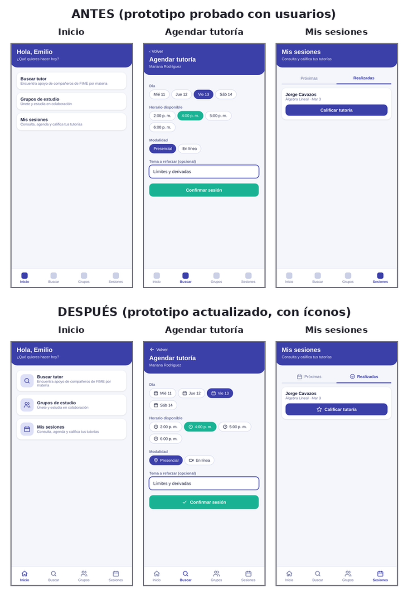
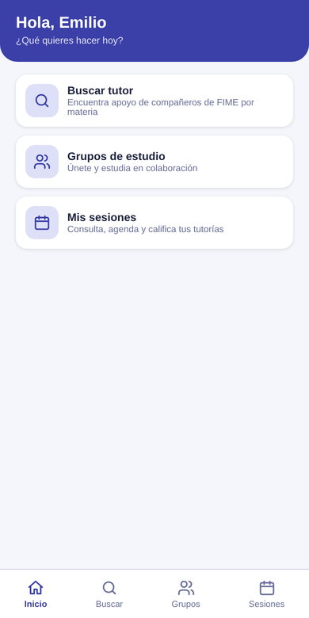
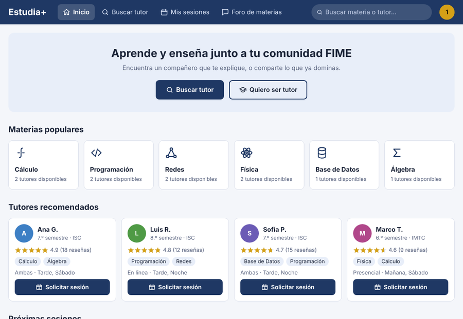

# Estudia+

Aplicación de tutorías y estudio colaborativo entre estudiantes de la FIME (UANL).
Proyecto final de **Interacción Humano-Computadora** · Facultad de Ingeniería Mecánica y Eléctrica, UANL.

**Autor:** José Emilio Salazar Cadena · [@EmilioSalazarC](https://github.com/EmilioSalazarC)

## Versiones

| Versión | Carpeta | Descripción |
|---|---|---|
| Prototipo de pruebas | [`prototipo-pruebas/`](prototipo-pruebas/) | Prototipo móvil de dos tareas completas (agendar y calificar una tutoría) usado en las pruebas con usuarios. |
| Prototipo actualizado | [`prototipo-actualizado/`](prototipo-actualizado/) | Mismo prototipo con íconos en los botones, tarjetas y barra de navegación. |
| Aplicación completa | [`app-completa/`](app-completa/) | Versión web con búsqueda de tutores, solicitud y gestión de sesiones, foro por materia y registro de tutores. |

## Cómo usarlo

No necesita instalación ni servidor. Cada carpeta tiene un `index.html` independiente:

1. Descarga o clona el repositorio.
2. Abre el `index.html` de la versión que quieras en el navegador (o el `index.html` de la raíz, que enlaza a las tres).

### Publicarlo con GitHub Pages
1. En el repositorio ve a **Settings → Pages**.
2. En *Build and deployment* elige **Deploy from a branch**, rama `main` y carpeta `/ (root)`.
3. Guarda. En un par de minutos estará disponible en `https://<tu-usuario>.github.io/<nombre-del-repositorio>/`.

## Capturas

| Prototipo actualizado | Aplicación completa |
|---|---|
|  |  |

## Tecnologías

HTML, CSS y JavaScript sin librerías externas. Cada versión es un solo archivo.

## Notas

- Es una **versión de demostración**: los tutores, materias y sesiones son datos de ejemplo.
- En el inicio de sesión solo se valida que el correo termine en `@uanl.edu.mx`. La verificación real del correo requeriría un servidor.
- La aplicación completa guarda su estado en el navegador (`localStorage`), por lo que los datos quedan solo en tu equipo.
- Los prototipos están pensados para verse como teléfono; en pantallas grandes aparecen dentro de un marco.

## Cambios del prototipo actualizado

- Barra inferior con íconos de casa, lupa, personas y calendario.
- Íconos en las tarjetas del inicio.
- Íconos en los botones de acción: agendar, confirmar, calificar, enviar, entrar y registrarse.
- Íconos en las opciones de día, horario y modalidad (presencial o en línea).
- Flecha en el botón *Volver* y en las pestañas de sesiones.
